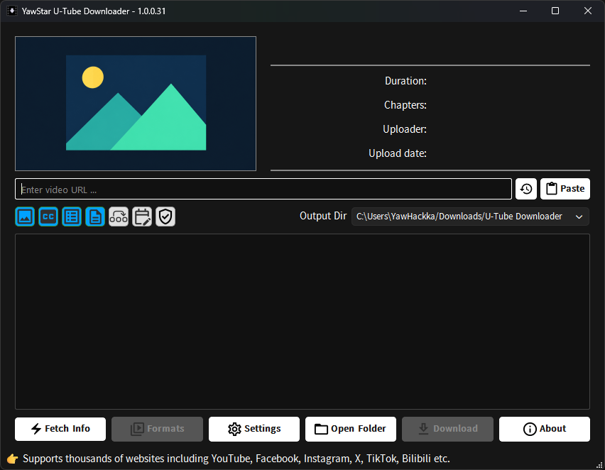
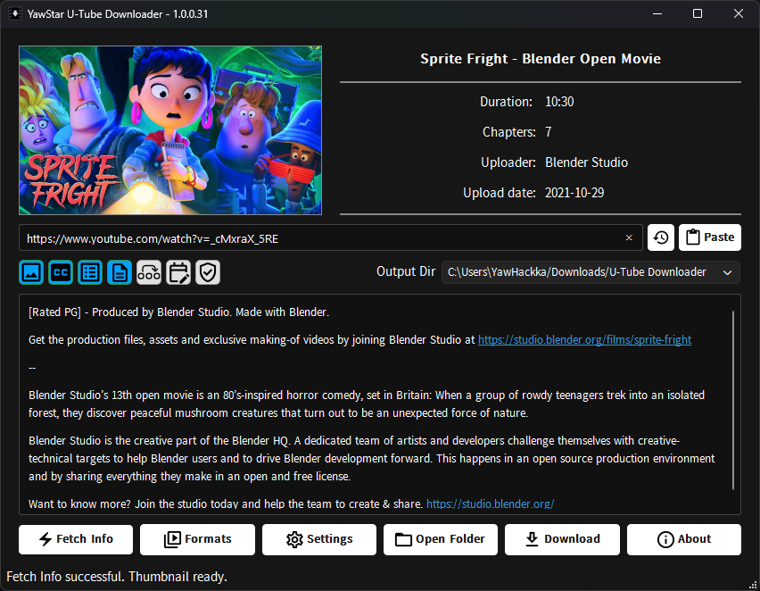
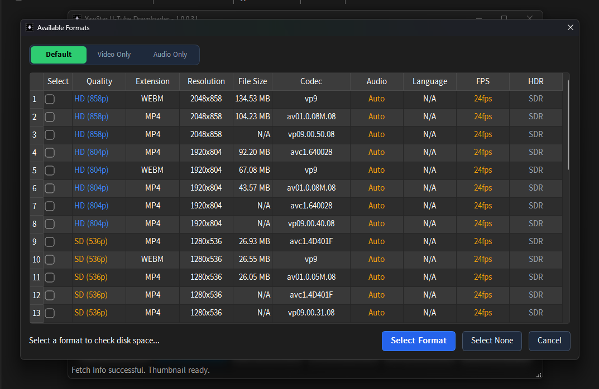
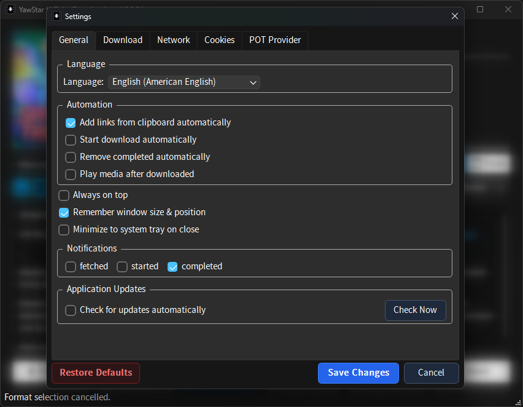
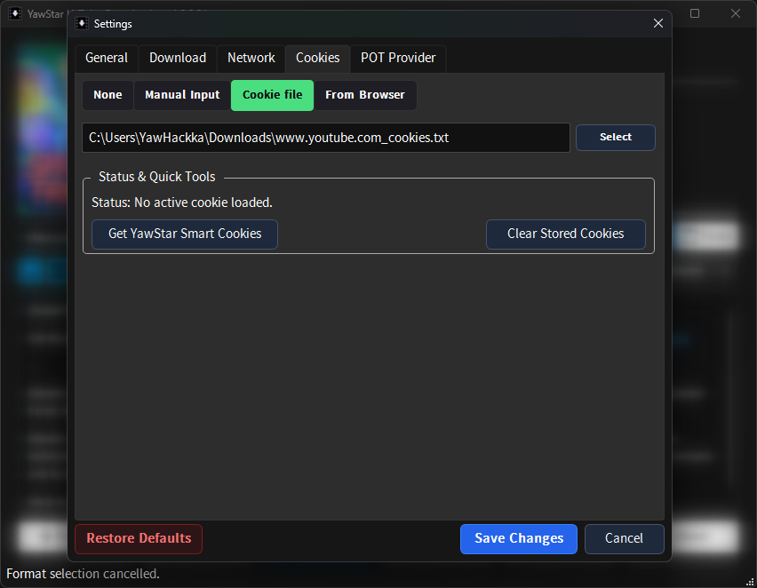
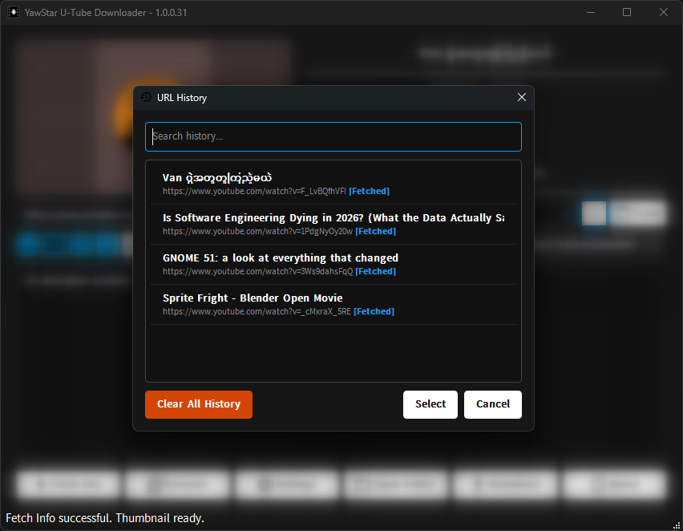
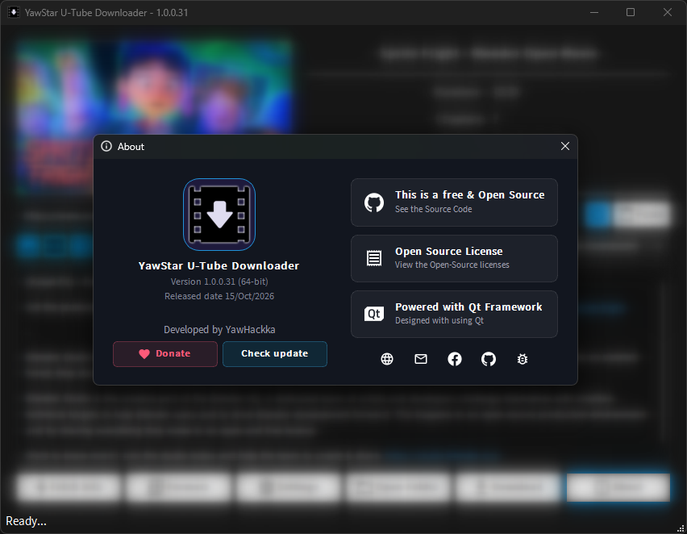

<div id="top"></div>
<div align="center">


# YawStar U-Tube Downloader

**YouTube နှင့် အခြားသော ဝဘ်ဆိုဒ်များစွာမှ အရည်အသွေးမြင့် ဗီဒီယိုများ၊ အသံဖိုင်များနှင့် ပလေးလစ် (Playlist) များကို `yt-dlp`၊ `Deno` နှင့် `ffmpeg` တို့ကို အသုံးပြု၍ လွယ်ကူလျင်မြန်စွာ ဒေါင်းလုဒ်လုပ်နိုင်ပါသည်။ Python နှင့် PySide6 (Qt) ဖြင့် တည်ဆောက်ထားသည့် ခေတ်မီပြီး အဆင့်မြင့်သော UI ပါဝင်သည့် Desktop အက်ပ်တစ်ခု ဖြစ်ပါသည်။**

**YouTube၊ Facebook၊ Twitter/X၊ Bilibili နှင့် [ဝဘ်ဆိုဒ်ပေါင်း ၁၀၀၀ ကျော်](https://github.com/yt-dlp/yt-dlp/blob/master/supportedsites.md)မှ ဗီဒီယိုများကို လွယ်ကူစွာ ဒေါင်းလုဒ် လုပ်နိုင်ပါသည်။**


[](https://github.com/YawStar/U-Tube-Downloader/releases)


**မြန်မာ** | [English](./README.en-us.md)

</div>

---

## 📑 မာတိကာ (Table of Contents)

- [စခရင်ရှော့များ (Screenshots)](#-စခရင်ရှော့များ-screenshots)

- [အဓိက အင်္ဂါရပ်များ (Key Features)](#-အဓိက-အင်္ဂါရပ်များ-key-features)

- [ပရောဂျက် တည်ဆောက်ပုံ (Project Structure)](#-ပရောဂျက်-တည်ဆောက်ပုံ-project-structure)

- [စတင်အသုံးပြုခြင်း (Getting Started)](#-စတင်အသုံးပြုခြင်း-getting-started)

- [ဖွဲ့စည်းပုံနှင့် သိမ်းဆည်းမှု (Configuration & Storage)](#️-ဖွဲ့စည်းပုံနှင့်-သိမ်းဆည်းမှု-configuration--storage)

- [မူကွဲသမိုင်း အနှစ်ချုပ် (Version History Highlights)](#-မူကွဲသမိုင်း-အနှစ်ချုပ်-version-history-highlights)

- [ပူးပေါင်းပါဝင်ခြင်း (Contributing)](#-ပူးပေါင်းပါဝင်ခြင်း-contributing)

- [ဆော့ဖ်ဝဲရေးသားသူကို ပံ့ပိုးရန် (Support the Developer)](#-ဆော့ဖ်ဝဲရေးသားသူကို-ပံ့ပိုးရန်-support-the-developer)

- [ကျေးဇူးတင်လွှာ (Credits)](#-ကျေးဇူးတင်လွှာ-credits)

- [လိုင်စင် (License)](#-လိုင်စင်-license)

- [သတိပေးချက် (Disclaimer)](#️-သတိပေးချက်-disclaimer)

## 📸 စခရင်ရှော့များ (Screenshots)

<p align="center">
  <h3>Main Interface</h3>
  
</p>

<p align="center">
  <h3>Fetched Info</h3>
  
</p>

<p align="center">
  <h3>Format Selector</h3>
  
</p>

<p align="center">
  <h3>Settings</h3>
  
  
</p>

<p align="center">
  <h3>URL History Dialog</h3>
  
</p>

<p align="center">
  <h3>About Dialog</h3>
  
</p>

---

## 🌟 အဓိက အင်္ဂါရပ်များ (Key Features)

- **🚀 Advanced Process Engine**: လုပ်ငန်းစဉ်ပေါင်းစုံကို ချောမွေ့စွာ လုပ်ဆောင်နိုင်ရန်အတွက် native `QProcess` စနစ်ကို အသုံးပြုထားသည် (`yt-dlp`, `ffmpeg`, `deno`)။

- **📊 Real-time Progress Tracking**: ရာခိုင်နှုန်း၊ ဒေါင်းလုဒ်အမြန်နှုန်း၊ စုစုပေါင်းဖိုင်ဆိုဒ်၊ ကုန်ဆုံးချိန်၊ ခန့်မှန်းကျန်ရှိချိန် (ETA) နှင့် Windows Taskbar ပေါ်တွင် တိုက်ရိုက်ပြသပေးမှု (`ITaskbarList3`) တို့ကို ပြသပေးသည်။

- **🎛️ Format Selection Dialog**: လိုချင်သည့် ဗီဒီယိုနှင့် အသံဖိုင် အရည်အသွေးများကို သီးသန့်ရွေးချယ်နိုင်ခြင်း။

- **🎨 Rich Metadata & Media Embedding**: ဗီဒီယို Thumbnail များ၊ အခန်းများ (Chapters)၊ စာတန်းထိုးများ (Subtitles) နှင့် Metadata များကို ထည့်သွင်းပေးနိုင်ခြင်း။

- **📌 Magnet Window / Snap to Edges**: အက်ပ်ဝင်းဒိုးကို စခရင်ဘေးစွန်းများသို့ ရွှေ့သည့်အခါ အလွယ်တကူ ကပ်သွားစေရန် ပြုလုပ်ပေးထားခြင်း။

- **📋 Automatic Clipboard Monitor**: Url တစ်ခုကို Copy ကူးယူလိုက်ရင် မီဒီယာလင့်ခ်များကို အလိုအလျောက် စစ်ဆေးဖမ်းယူပေးခြင်း။

- **🖼️ High-Res Thumbnail Viewer & Downloader**: မူရင်း HD ဗီဒီယို Thumbnail များကို ကြည့်ရှုရန်နှင့် သိမ်းဆည်းရန် Interactive context menu (`WebP`, `JPG`, `PNG`) ပါရှိခြင်း။

- **🍪 Cookie Management & Grabber**: Bot စစ်ဆေးမှုများ သို့မဟုတ် အသက်ကန့်သတ်ထားသော ဗီဒီယိုများကို ကျော်လွှားရန် authentication နည်းလမ်းများကို ထောက်ပံ့ပေးသည်။

- **🌐 Network & Proxy Controls**: Socket timeouts၊ proxy configs (`HTTP/SOCKS`) နှင့် အမြန်နှုန်း ကန့်သတ်ချက်များကို ထောက်ပံ့ပေးသည်။

- **🔔 Native System Tray Integration**: System Tray သို့ Minimize လုပ်ထားနိုင်ခြင်း၊ ပြီးဆုံးပါက Notification ပေးပို့ခြင်းတို့ ပါဝင်သည်။

- **📦 Built-in Dependency Downloader**: လိုအပ်သော external binaries များကို စစ်ဆေးဒေါင်းလုဒ်လုပ်ပေးနိုင်သော built-in dialog ပါရှိခြင်း။

- **🌍 Multi-language & Font Support**: မြန်မာဖောင့်များ (Pyidaungsu, YawStar UI, ZawgyiOne2008) နှင့် UI ဘာသာပြန်ဆိုမှုများ ပါဝင်သည်။

## ⬇️ Download

သင့်ပလပ်ဖောင်းအတွက် နောက်ဆုံးထွက်ဗားရှင်းကို [**Releases**](https://github.com/YawStar/U-Tube-Downloader/releases) မှာ ဒေါင်းလုဒ်လုပ်နိုင်ပါတယ်။ -

| Platform | File                          |
| -------- | ----------------------------- |
| Windows  | `.exe` installer              |
| macOS    | `.dmg`                        |
| Linux    | `.AppImage` / `.deb` / `.rpm` |

### ⌨️ Keyboard Shortcuts

| Shortcut               | Description                                                                         | Method / Function                |
| ---------------------- | ----------------------------------------------------------------------------------- | -------------------------------- |
| **`Ctrl + V`**         | ကလစ်ဘုတ်ထဲမှ URL ကို အလိုအလျောက်ကူးထည့်ပြီး အချက်အလက်များကို စတင်စစ်ဆေးသည်။         | `self.on_paste_clicked`          |
| **`Ctrl + L`**         | URL ထည့်သွင်းသည့်ကွက်လပ်သို့ ဖိုကပ်စ်ပို့ပြီး စာသားအားလုံးကို Select မှတ်သည်။       | `self._focus_url_input`          |
| **`Ctrl + Shift + X`** | URL ထည့်သွင်းသည့်ကွက်လပ်ကို ရှင်းလင်းဖျက်ဆီးသည်။                                    | `self._clear_url_input`          |
| **`Ctrl + O`**         | လက်ရှိ ဒေါင်းလုဒ်ဖိုလ်ဒါကို ဖွင့်သည်။                                               | `self.on_open_folder_clicked`    |
| **`Ctrl + S`**         | ဗီဒီယို သို့မဟုတ် ပလေလစ်၏ Thumbnail ပုံကို သိမ်းဆည်းသည်။                            | `self.save_thumbnail`            |
| **`F5` / `Ctrl + R`**  | ထည့်သွင်းထားသော URL အတွက် အချက်အလက်များကို စတင်ရယူသည်။                              | `self.on_fetch_info_clicked`     |
| **`F4`**               | မီဒီယာအတွက် ဖော်မတ်ရွေးချယ်သည့် ဒိုင်ယာလော့ခ်ကို ဖွင့်သည်။                          | `self.on_select_formats_clicked` |
| **`F9`**               | ဒေါင်းလုဒ်လုပ်ခြင်းကို စတင်ခြင်း သို့မဟုတ် ရပ်တန့်သည်။                              | `self.on_download_clicked`       |
| **`Ctrl + H`**         | ဒေါင်းလုဒ် မှတ်တမ်း ဒိုင်ယာလော့ခ်ကို ဖွင့်သည်။                                      | `self.on_history_clicked`        |
| **`Ctrl + ,`**         | အက်ပ်၏ ဆက်တင်များ ဒိုင်ယာလော့ခ်ကို ဖွင့်သည်။                                        | `self.on_settings_clicked`       |
| **`F1`**               | အက်ပ်အကြောင်း အသေးစိတ်ဖော်ပြသည့် About ဒိုင်ယာလော့ခ်ကို ဖွင့်သည်။                   | `self.on_about_button_clicked`   |
| **`Ctrl + Shift + P`** | ကိုယ်ရေးကိုယ်တာ မုဒ် (Privacy mode) ကို ဖွင့်/ပိတ် ပြုလုပ်သည်။                      | `self.change_ui_mode`            |
| **`Esc`**              | လုပ်ဆောင်နေဆဲ လုပ်ငန်းစဉ်ကို ရပ်တန့်သည် (သို့) URL ကွက်လပ်သို့ ဖိုကပ်စ်ပြန်ပို့သည်။ | `self._on_escape_pressed`        |
| **`Ctrl + Q`**         | နောင်တွင် ထည့်သွင်းမည့် တန်းစီစနစ်အတွက် ချန်လှပ်ထားသည်။                             | `self.on_queue_clicked`          |

## 🛠️ ပရောဂျက် တည်ဆောက်ပုံ (Project Structure)

```
YawStar-U-Tube-Downloader/
│   .gitignore                  # Git Version Control ထဲ မထည့်ချင်သော ဖိုင်များကို သတ်မှတ်သည့်ဖိုင်
│   .python-version             # uv package manager အတွက် သုံးမည့် Python version Pin ဖိုင်
│   build.py                    # Application ကို Executable (.exe) အဖြစ် ပြောင်းလဲပေးသည့် Build Script
│   Changelog.txt               # Version တစ်ခုချင်းစီ၏ ပြင်ဆင်ချက်မှတ်တမ်းများ
│   LICENSE                     # Open Source License အချက်အလက်များ (MIT License)
│   main.py                     # Program စတင်ပွင့်မည့် ပင်မ Main Entry Point ဖိုင်
│   pyproject.toml              # Project ၏ Dependencies နှင့် Metadata များကို သတ်မှတ်သည့် Configuration ဖိုင်
│   README.md                   # Project အကြောင်း ရှင်းလင်းချက် Documentation ဖိုင်
│   requirements.txt            # Python Packages များ စာရင်း
│   uv.lock                     # uv package manager ၏ Dependency Lock ဖိုင်
│
├───app_platform/               # Application Run-time Platform နှင့် ဆက်စပ်သော Module များ
│       application.py          # App တစ်ခုထဲသာ ပွင့်စေရန် ထိန်းချုပ်ပေးသည့် (Singleton) Handler
│
├───assets/                     # App တွင် သုံးမည့် UI အရင်းအမြစ် Asset ဖိုင်များ
│   │   resources.qrc           # Qt Resource XML Manifest ဖိုင်
│   │   resources_rc.py         # PySide6 သို့ Compile လုပ်ထားပြီးသား Resource ဖိုင်
│   │   __init__.py
│   │
│   ├───fonts/                  # App ထဲတွင် ပါဝင်သည့် မြန်မာ ဖောင့်များ
│   │       pyidaungsu.ttf      # Pyidaungsu Font
│   │       yawstar_ui.ttf      # YawStar Custom UI Font
│   │       zawgyione2008.ttf   # Zawgyi Font
│   │
│   ├───icons/                  # Taskbar နှင့် Status Icon များ (.ico)
│   │       about.ico           # About Dialog Icon
│   │       app_icon.ico        # Main App Icon
│   │       completed.ico       # Download ပြီးစီးကြောင်း Icon
│   │       downloading.ico     # Download လုပ်နေဆဲ Icon
│   │       error.ico           # Error ဖြစ်ပေါ်သည့် Icon
│   │       exec.ico            # Process Executing Icon
│   │       history.ico         # Download History Icon
│   │       info.ico            # Information Icon
│   │       waiting.ico         # Waiting/Pending Icon
│   │
│   └───images/                 # UI Context Menu နှင့် Button များတွင် သုံးသည့် SVG/PNG/GIF ဖိုင်များ
│           about.svg           # About SVG Icon
│           bug_report.svg      # Bug Report SVG Icon
│           chapters.svg        # Video Chapters SVG Icon
│           default_thumbnail.jpg# Thumbnail မရသည့်အခါ ပြမည့် Default ပုံ
│           download.svg        # Download Button Icon
│           fetch_Info.svg      # Fetch Info Button Icon
│           formats.svg         # Format Selector Icon
│           github.svg          # GitHub Link Icon
│           globe.svg           # Language/Website Icon
│           groups.svg          # Social Group Icon
│           heart.svg           # Donation/Support Icon
│           heart_pink.svg      # Support Icon (Pink)
│           history.svg         # History List Icon
│           license.svg         # License Information Icon
│           loading.gif         # Loading Progress GIF animation
│           mail.svg            # Contact Email Icon
│           metadata.svg        # Metadata Setting Icon
│           m_time.svg          # Duration/Time Icon
│           open_folder.svg     # Folder Open Icon
│           paste.svg           # Paste URL Icon
│           qt_dark.svg         # Qt Dark Theme Logo
│           settings.svg        # Preferences/Settings Icon
│           setup_icon.png      # Installer Setup Image
│           subtitles.svg       # Subtitle Option Icon
│           thumbnail.svg       # Thumbnail View Icon
│           translate.svg       # Translation Icon
│
├───controllers/                # Logic Control နှင့် Process စီမံခန့်ခွဲသည့် Controller များ
│       download_controller.py  # Download ရယူသည့် Process များကို ထိန်းချုပ်သည့် Logic
│       fetch_controller.py     # Video/Playlist Information Fetch လုပ်သည့် Logic
│       __init__.py
│
├───core/                       # Main System Core Services နှင့် Logic များ
│   │   clipboard_monitor.py    # Clipboard (Copy ကူးလိုက်သည့် Link) များကို စောင့်ကြည့်သည့် Thread
│   │   config_manager.py       # User Settings (JSON Configuration) စီမံပေးသည့် Manager
│   │   constants.py            # App ၏ သတ်မှတ်ချက် Constant တန်ဖိုးများ
│   │   db_manager.py           # History နှင့် Database သိုလှောင်မှုကို စီမံသည့် Manager
│   │   dependency_downloader.py# External Binaries (yt-dlp, ffmpeg, deno) ဒေါင်းလုဒ်ဆွဲပေးသည့် GUI
│   │   dependency_downloader1.py# Dependency Downloader နမူနာ/အပို ဖိုင်
│   │   global_constants.py     # App Version, Company Name စသည့် Global Metadata တန်ဖိုးများ
│   │   __init__.py
│   │
│   └───services/               # Core Background Service များ
│           file_opener.py      # Download ပြီးစီးသော ဖိုင်/Folder များကို ဖွင့်ပေးသည့် Service
│           font_service.py     # Custom Font Loading နှင့် Management Service
│           notification_service.py # System Tray Notifications များ ထုတ်ပေးသည့် Service
│           notification_service1.py # Notification Service နမူနာ/အပို ဖိုင်
│           taskbar_service.py  # Windows Taskbar Progress API ကို ထိန်းချုပ်သည့် Service
│           thumbnail_service.py# HD Video Thumbnail များ Downloader/Viewer Service
│           yt_dlp_service.py   # yt-dlp Process နှင့် Command Arguments စီမံသည့် Service
│           __init__.py
│
├───dist/                       # Installer (Inno Setup) နှင့် Output Executable ဖိုင်များထားရာ
│       app_icon.ico            # Installer Desktop Icon
│       License Agreement.txt   # Software License စာချုပ်ဖိုင်
│       Setup.iss               # Inno Setup Script (Exe Installer ထုတ်ရန်)
│       setup_icon.ico          # Installer Setup File Icon
│       v1.0.0.29_x64_config.json # Build Config Snapshot
│       version-file.txt        # Executable ၏ File Version Metadata
│       YawStar.URL             # App Website Shortcut Link
│
├───screenshots/                # Documentation (README) အတွက် Application UI စခရင်ရှော့များ
│       about_dialog.png        # About Dialog Screenshot
│       fetched_info.png        # Fetched Information UI Screenshot
│       format_selection.png    # Format Selection Dialog Screenshot
│       main_window.png         # Main Application Window Screenshot
│       preferences_cookies.png # Cookie Settings Panel Screenshot
│       preferences_general.png # General Settings Panel Screenshot
│       url_history.png         # URL History Dialog Screenshot
│
├───ui/                         # User Interface (PySide6 UI) ဖိုင်များ
│       about.py                # About Dialog UI Logic
│       format_dialog.py        # Audio/Video Format ရွေးချယ်သည့် UI Logic
│       history_dialog.ui       # Qt Designer History Window File
│       i_taskbar3.py           # Windows Taskbar API COM Bindings
│       settings_dialog.py      # Preferences/Settings Panel UI Logic
│       settings_dialog.ui      # Qt Designer Settings Window File
│       ui_history.py           # Python ဖြင့် ဖွဲ့စည်းထားသော History UI View
│       ui_main.py              # Main Window UI Bindings နှင့် Layouts
│
└───utils/                      # Helper & Utility Functions များ
        logger.py               # Application Log မှတ်တမ်းတင်သည့် Utility
        process_utils.py        # Subprocess နှင့် Process Management Utilities
        text_utils.py           # Text Processing, Title Sanitation နှင့် Format Utility များ
        __init__.py

```

## 🚀 စတင်အသုံးပြုခြင်း (Getting Started)

### လိုအပ်ချက်များ (Prerequisites)

- **Python 3.9+ (Recommand: 3.13.13)**

- **uv** (အလွန်လျင်မြန်သော Python package နှင့် project manager)

- **ထောက်ပံ့ပေးသော OS**: Windows 10/11 (taskbar integration ပါဝင်သည်), Linux, macOS။

### `uv` ဖြင့် တပ်ဆင်ခြင်းနှင့် လုပ်ဆောင်ခြင်း

1. **Repository ကို Clone လုပ်ရန်:**

   ```
   git clone https://github.com/yawstar/u-tube-downloader.git
   ```

2. **Directory သို့ ဝင်ရန်:**

   ```
   cd u-tube-downloader
   ```

3. **Dependencies များကို Sync လုပ်ပြီး တပ်ဆင်ရန်:**

   ```
   uv sync
   ```

4. **အက်ပ်ကို စတင်လည်ပတ်ရန်:**

   ```
   uv run main.py
   ```

## ⚙️ ဖွဲ့စည်းပုံနှင့် သိမ်းဆည်းမှု (Configuration & Storage)

အက်ပ်၏ configuration နှင့် cache ဒေတာများကို အောက်ပါ ပလပ်ဖောင်း သတ်မှတ်ထားသော user data directories များတွင် အလိုအလျောက် သိမ်းဆည်းပေးသည်-

- **Windows**: `%APPDATA%\YawStar\YawStar U-Tube Downloader\config.json`

- **Linux**: `~/.local/share/YawStar/YawStar U-Tube Downloader/config.json`

- **macOS**: `~/Library/Application Support/YawStar/YawStar U-Tube Downloader/config.json`

### ထောက်ပံ့ထားသော Cookie မုဒ်များ (Supported Cookie Modes)

- **None**: အထောက်အထားမပါဘဲ အများပြည်သူသုံး မီဒီယာများကို ဒေါင်းလုဒ်လုပ်ခြင်း။

- **Browser**: တပ်ဆင်ထားသော ಬ್ರೌಸರ್‌များ (Chrome, Edge, Firefox, Brave) မှ cookies များကို တိုက်ရိုက်ထုတ်ယူခြင်း။

- **File**: `.txt` cookie ဖိုင်ကို တင်သွင်းခြင်း (Netscape format)။

- **Manual**: ဆက်တင်များတွင် cookie စာသားကို တိုက်ရိုက်ကူးထည့်ခြင်း။

## 📝 မူကွဲသမိုင်း အနှစ်ချုပ် (Version History Highlights)

- **v1.0.0.31**: YouTube Playlist များကို ဒေါင်းလုဒ် ပြုလုပ်နိုင်။
- **v1.0.0.29**: HD Thumbnail exporter & Auto-Play on complete။
- **v1.0.0.28**: Windows Taskbar integration (`ITaskbarList3`), PEP 8 refactoring, Singleton instance lock။
- **v1.0.0.27**: Enhanced cookies handling & title length sanitation။
- **v1.0.0.26**: System Tray background downloading & single instance execution။
- **v1.0.0.21**: Format selection dialog နှင့် rich Preferences/Settings panel။
- **v1.0.0.14**: Qt `QProcess` သို့ process management ကို ပြောင်းရွှေ့ခဲ့ခြင်း။

## 🤝 ပူးပေါင်းပါဝင်ခြင်း (Contributing)

ပါဝင်ကူညီမှုများ၊ ပြဿနာများနှင့် လုပ်ဆောင်ချက်အသစ် တောင်းဆိုမှုများကို ကြိုဆိုပါတယ်!
[issues page](../../issues) ကို စစ်ဆေးရန် သို့မဟုတ် pull request တင်သွင်းရန် ဖိတ်ခေါ်ပါတယ်။

## 💖 ဆော့ဖ်ဝဲရေးသားသူကို ပံ့ပိုးရန် (Support the Developer)

ဤအက်ပ်သည် အသုံးဝင်သည်ဟု ယူဆပါက ဖွံ့ဖြိုးတိုးတက်မှုကို အောက်ပါအတိုင်း ပံ့ပိုးနိုင်ပါသည်-

- ⭐ ဤ repository ကို Star ပေးပါ

- 🐛 အမှားများကို သတင်းပို့ရန် သို့မဟုတ် [Issues](../../issues) မှတဆင့် အကြံပြုပါ

- ❤️ [Donate](https://yawstardancebox.github.io/donate/) ပြုလုပ်ပါ

- 🌍 ဘာသာပြန်ဆိုရာတွင် ကူညီပေးပါ

## 🙏 ကျေးဇူးတင်လွှာ (Credits)

- [yt-dlp](https://github.com/yt-dlp/yt-dlp)

- [FFmpeg](https://ffmpeg.org/)

- [Deno](https://deno.land/)

- [PySide6](https://doc.qt.io/qtforpython/)

## 📄 လိုင်စင် (License)

ဤပရောဂျက်သည် MIT License အောက်တွင် လိုင်စင်ရရှိထားပါသည် — အသေးစိတ်အတွက် [LICENSE](LICENSE) ဖိုင်ကို ကြည့်ပါ။

## ⚠️ သတိပေးချက် (Disclaimer)

ယခု Application ကို **ကိုယ်ပိုင်သုံးစွဲရန်အတွက်သာ** ရည်ရွယ်ပါသည်။ ကျေးဇူးပြု၍ မူပိုင်ခွင့် ဥပဒေများနှင့် သင်ဒေါင်းလုဒ်လုပ်သည့် ဝဘ်ဆိုဒ်များ၏ ဝန်ဆောင်မှုစည်းမျဉ်းများကို လေးစားလိုက်နာပါ။ အလွဲသုံးစားလုပ်မှုတစ်စုံတစ်ရာအတွက် ဆော့ဖ်ဝဲရေးသားသူတွင် တာဝန်မရှိပါ။

---

<div align="center">

**[⬆ အပေါ်သို့ ပြန်သွားရန်](#top)**

ယောဟက္က က 💚 ဖြင့်ဖန်တီးသည်

</div>
</dev>